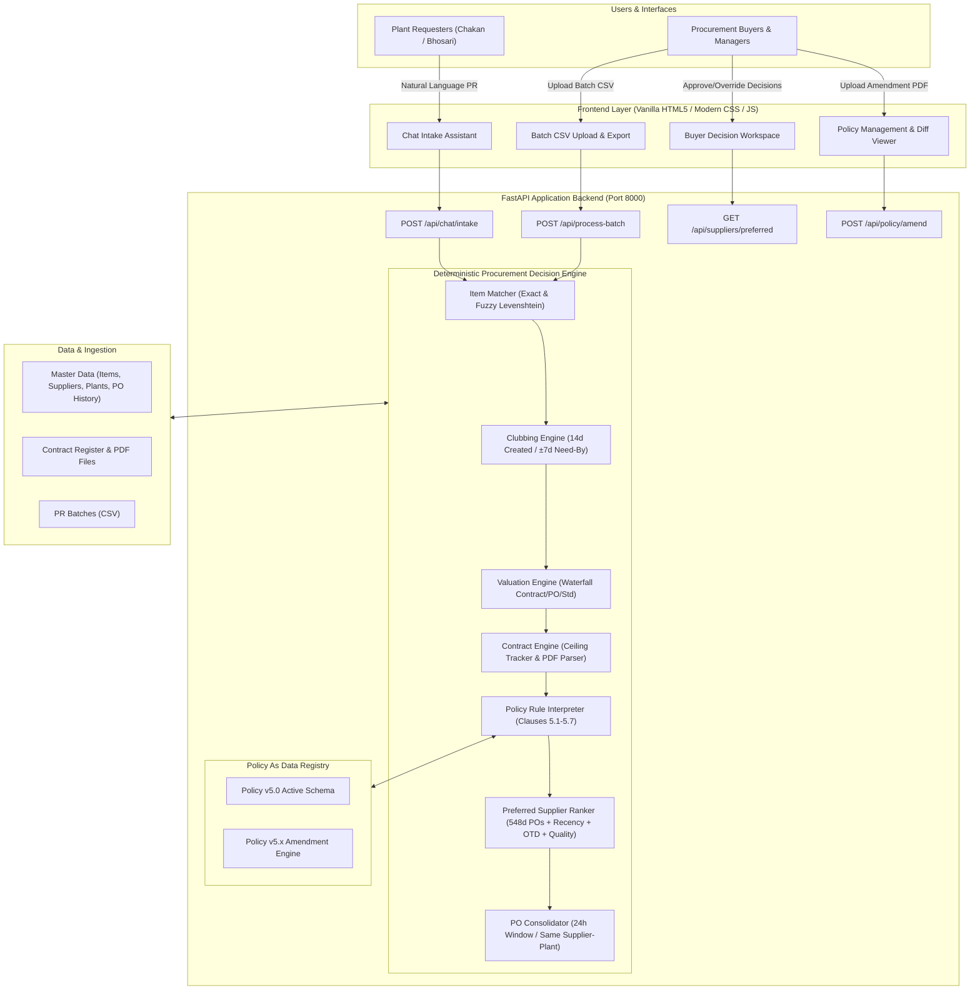

# Cantill ProcureAI — System Architecture & Data Flow

## 1. System Context & Component Architecture

Cantill ProcureAI operates as a dual-surface intelligent procurement platform:
- **Surface 1: Conversational Chat Intake** (for plant employees raising ad-hoc PRs).
- **Surface 2: Batch Processing Engine & Buyer Workspace** (for mass PR evaluation, policy versioning, and buyer override/approval).



---

## 2. Decision Pipeline & Data Flow

Every PR line passes through a deterministic 7-step pipeline:

```text
Step 1: Item Resolution
  ├── Code provided? -> Exact match to item_master
  ├── Free text? -> Fuzzy match against item_master (threshold >= 82%)
  └── No match? -> resolved_item_code = 'NEW' (routes immediately to NEW_ITEM_SOURCING)

Step 2: Requirement Clubbing (Anti-Split Rule)
  ├── Sort order: creation_time ASC, pr_no ASC, pr_line ASC
  ├── Match criteria: Same resolved_item_code, same plant, created within 14 days, need-by within ±7 days
  └── Requirement Date = creation_date of first line; Emergency = ANY line marked Emergency

Step 3: Requirement Valuation
  ├── Total Quantity = sum of clubbed line quantities
  └── Unit Price Priority:
        1. Rate of applicable contract with remaining ceiling
        2. Lowest rate among applicable contracts (if all out of ceiling)
        3. Most recent PO unit price in 365 days prior to requirement date
        4. Item master standard price
      Requirement Value = Total Quantity × Unit Price

Step 4: Contract Ceiling Evaluation
  ├── Covered item + Active supplier + Valid on requirement date
  ├── Consumed Value + Req Value <= Contract Ceiling
  └── If multiple contracts valid: choose lowest rate with ceiling room

Step 5: Sequential Policy Evaluation (Clauses 5.1 to 5.7)
  ├── 5.1: item_type == 'Capex' -> CAPEX_SOURCING (Suggest 5)
  ├── 5.2: contract available -> CONTRACT_PO (Contract Supplier @ Contract Rate)
  ├── 5.3: Emergency AND Value <= 5,00,000 AND Active PO in 365d -> EMERGENCY_PO (1st Preferred @ Ref Price)
  ├── 5.4: Value < 2,00,000 AND Active PO in 365d -> SPOT_PO (1st Preferred @ Ref Price)
  ├── 5.5: Value < 10,00,000 (or unproven item) -> RFQ (Suggest 3)
  └── 5.6: Value >= 10,00,000 -> RFP (Suggest 5)

Step 6: Preferred Supplier Ranking & Suggestions
  ├── Preferred List: Active suppliers with PO in 548d OR contract covering item
  ├── Composite score = Recency + ContractBonus + POVolume + OnTimeDelivery + Quality
  └── Sourcing Suggestion Top-Up: Fill to 3 (RFQ) or 5 (RFP/Capex) from item category

Step 7: Purchase Order Consolidation
  ├── Same supplier, same plant, same route (CONTRACT_PO, EMERGENCY_PO, SPOT_PO)
  └── Raised within 24 hours of first requirement's creation time on that PO
```

---

## 3. Official Output CSV Schema (Section 4 Compliance)

The application produces outputs with the exact 13 columns required by Cantill.ai:

| Column | Description | Example |
|---|---|---|
| `pr_no` | As in input | `PR-26-00019` |
| `pr_line` | As in input | `1` |
| `resolved_item_code` | Matched item code or `NEW` | `ITM-1002` |
| `group_id` | Requirement ID (clubbed lines share it) | `REQ-0001` |
| `po_id` | PO number for lines ending in PO; empty for sourcing | `PO-0011` |
| `decision` | `PO` or `SOURCING_REQUEST` | `PO` |
| `route` | One of: `CONTRACT_PO`, `EMERGENCY_PO`, `SPOT_PO`, `RFQ`, `RFP`, `CAPEX_SOURCING`, `NEW_ITEM_SOURCING`, `NOT_PROCESSED` | `CONTRACT_PO` |
| `supplier_id` | Assigned supplier for POs; empty for sourcing | `S001` |
| `unit_price` | Agreed unit price for POs | `9169.00` |
| `group_value_inr` | Total requirement value in INR | `137531.00` |
| `suggested_supplier_ids` | Ranked supplier suggestions separated by `;` | `S014;S013;S016` |
| `policy_version` | Active policy version applied | `v5.0` |
| `reason` | Clause cited and contract/PO relied upon | `Clause 5.2 via contract RC-2025-011` |
